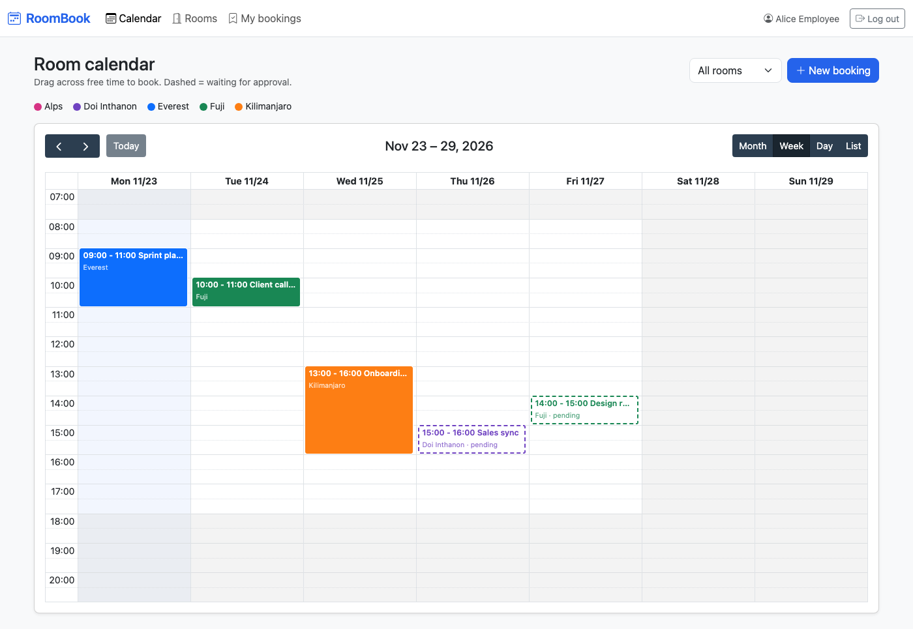
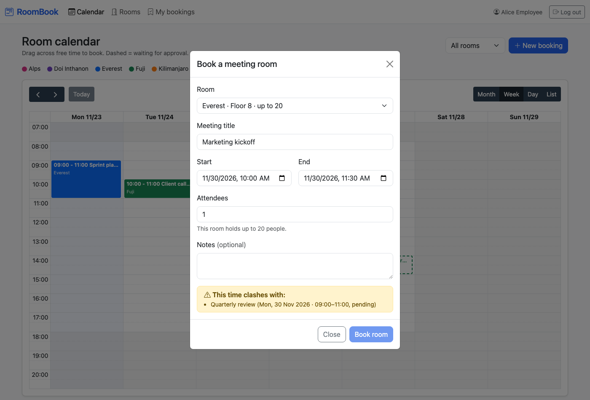
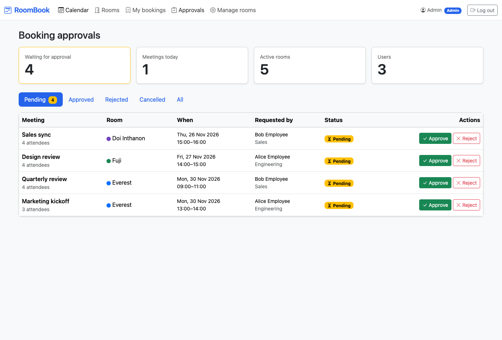
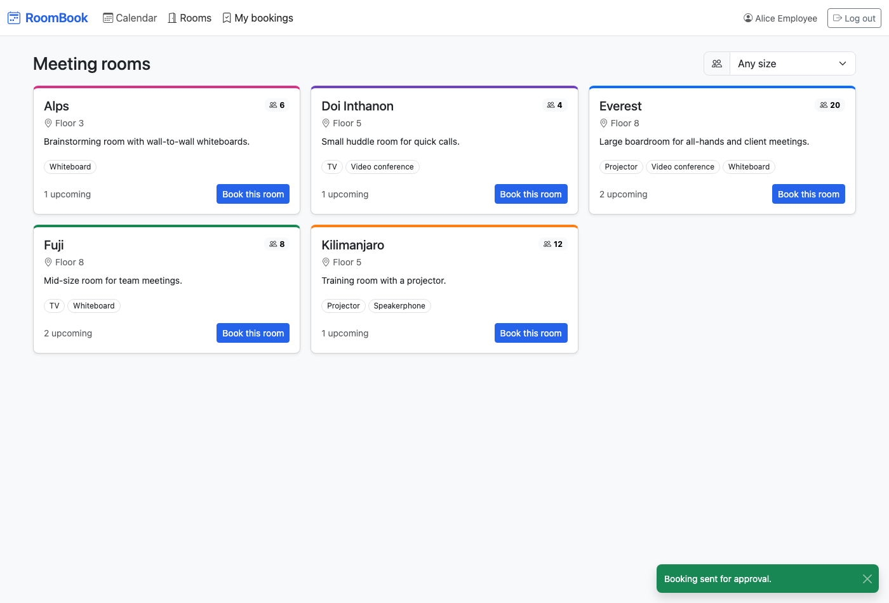
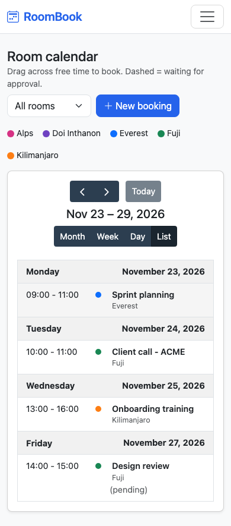

# Meeting Room Booking System

[](https://github.com/forworkyanika/meeting-room-booking/actions/workflows/ci.yml)

A full-stack meeting room booking app: employees book rooms on an interactive calendar, the system blocks double bookings, and admins approve or reject requests.

**Stack:** PHP 8 · Laravel 13 · PostgreSQL 17 · Vue 3 · Pinia · Vue Router · Bootstrap 5 · FullCalendar 6 · Vite · Sanctum · PHPUnit



## Screenshots

| Live conflict warning while booking | Admin approval queue |
|---|---|
|  |  |

| Rooms | Mobile |
|---|---|
|  |  |

## Features

- **Interactive calendar.** Month, week, day, and list views. Drag across free time to book, click a booking for details. Filter by room. Pending bookings show with a dashed outline.
- **Booking conflict detection** at three layers:
  1. The booking form checks availability live (`GET /api/availability`) and disables **Book** when the time clashes.
  2. `BookingService` re-checks inside a transaction, holding a row lock on the room, and returns `409 Conflict` with the clashing bookings.
  3. A PostgreSQL `EXCLUDE USING gist` constraint makes overlapping active bookings impossible at the database level, even under a race.
- **Admin approval workflow.** `pending → approved | rejected`, and `pending/approved → cancelled`. A rejection requires a reason, which the requester sees. Admins' own bookings are approved automatically.
- **Role-based access.** Employees see and cancel only their own bookings. Admin routes are protected by a gate (`can:admin`).
- **Room management.** Admins can create, edit, deactivate, and delete rooms. Rooms with booking history can only be deactivated, not deleted.
- **Validation.** Bookings must start in the future and last between 15 minutes and 8 hours, attendees cannot exceed room capacity, and inactive rooms cannot be booked.
- **Responsive UI.** Built with Bootstrap 5. The calendar switches to list view on phones.

## Quick start

Requirements: PHP 8.3+ (with `pdo_pgsql`), Composer, Node 20+, PostgreSQL 14+.

```bash
git clone https://github.com/forworkyanika/meeting-room-booking.git && cd meeting-room-booking
composer install
npm install

cp .env.example .env            # then set DB_USERNAME / DB_PASSWORD
php artisan key:generate

createdb meeting_room_booking
php artisan migrate --seed      # creates tables + demo data

npm run build                   # or `npm run dev` for hot reload
php artisan serve               # http://localhost:8000
```

| Demo account | Email | Password |
|---|---|---|
| Admin | `admin@example.com` | `password` |
| Employee | `user@example.com` | `password` |
| Employee | `bob@example.com` | `password` |

### Tests

Feature tests run against a real PostgreSQL database, so the exclusion constraint is exercised too:

```bash
createdb meeting_room_booking_test
php artisan test
```

## REST API

All endpoints are under `/api` and return JSON. Authenticate with `Authorization: Bearer <token>` from `/login`.

| Method | Endpoint | Who | Purpose |
|---|---|---|---|
| POST | `/register`, `/login` | public | Get a token |
| POST | `/logout` · GET `/me` | user | Revoke token · current user |
| GET | `/rooms` · `/rooms/{id}` | user | List / show rooms (`?min_capacity=`) |
| GET | `/calendar?start=&end=&room_id=` | user | Events for FullCalendar |
| GET | `/availability?room_id=&start_time=&end_time=` | user | `{ available, conflicts[] }` |
| GET | `/bookings` | user | Own bookings (`?when=upcoming\|past&status=`); admin: `?scope=all` |
| POST | `/bookings` | user | Create (`201`, `409` on clash, `422` on validation) |
| GET | `/bookings/{id}` | owner/admin | Show |
| PATCH | `/bookings/{id}/cancel` | owner/admin | Cancel an upcoming booking |
| PATCH | `/admin/bookings/{id}/approve` | admin | Approve (optional `note`) |
| PATCH | `/admin/bookings/{id}/reject` | admin | Reject (`note` required) |
| GET | `/admin/dashboard` | admin | Counts for the admin page |
| POST/PUT/DELETE | `/admin/rooms[/{id}]` | admin | Manage rooms |

## Project structure

```
app/
  Enums/                BookingStatus, UserRole
  Exceptions/           BookingConflictException (409), InvalidBookingTransitionException (422)
  Http/Controllers/Api/ thin controllers: validate → call service → return resource
  Http/Requests/        validation rules (FormRequest)
  Http/Resources/       JSON shape of each model
  Models/               User, Room, Booking (+ scopes active(), overlapping())
  Policies/             BookingPolicy (view / cancel)
  Services/             BookingService: conflict check + state transitions
database/migrations/    schema incl. the PostgreSQL EXCLUDE constraint
resources/js/           Vue SPA (pages/, components/, stores/, router/, api/)
routes/api.php          REST routes · routes/web.php serves the SPA shell
tests/Feature/          conflict, approval workflow, auth
```

A detailed walkthrough in Thai, covering how each part works, the tech stack, and PHP basics, is in [docs/HOW-IT-WORKS.th.md](docs/HOW-IT-WORKS.th.md).
